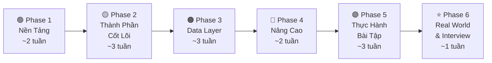

# 🗺️ Lộ Trình Học System Design Primer — Từ Cơ Bản Đến Nâng Cao

> Lộ trình học toàn bộ nội dung trong project [system-design-primer](README.md), được sắp xếp theo thứ tự từ nền tảng → trung cấp → nâng cao → thực hành.
>
> ⏱️ **Tổng thời gian ước tính**: 12–16 tuần (học 1–2 giờ/ngày)

## Cách dùng lộ trình

- Mỗi ngày: đọc nội dung được liên kết, ghi lại trade-off bằng lời của mình, rồi hoàn thành bài tập/output đi kèm.
- Chỉ đánh dấu một mục sau khi bạn có thể giải thích lại mà không nhìn tài liệu. Với bài thiết kế, luôn tự làm trước khi mở solution.
- Tên các mục bám theo [README](README.md). Liên kết nội bộ là đường dẫn tương đối để file hoạt động cả trên GitHub lẫn khi clone repository.
- Nếu mới với backend/distributed systems, dành thêm thời gian cho HTTP, SQL, cấu trúc dữ liệu cơ bản và Python trước hoặc song song với Phase 1.

---

## 📋 Tổng Quan Lộ Trình

| Phase | Chủ đề | Thời gian | Độ khó |
|:-----:|--------|:---------:|:------:|
| 1 | Nền tảng & Tư duy Scalability | ~2 tuần | 🟢 Cơ bản |
| 2 | Thành phần cốt lõi (DNS, CDN, LB, Proxy) | ~3 tuần | 🟡 Trung bình |
| 3 | Data Layer (Database, Cache, Async) | ~3 tuần | 🟠 Trung bình–Khó |
| 4 | Communication, Security & Ước tính | ~2 tuần | 🔴 Nâng cao |
| 5 | Bài tập thực hành (System Design + OOD) | ~3 tuần | 🔴 Nâng cao |
| 6 | Real World Architectures & Interview Prep | ~1 tuần | ⭐ Tổng hợp |

---

## 🟢 Phase 1: Nền Tảng & Tư Duy Scalability (~2 tuần)

> **Mục tiêu**: Hiểu bức tranh tổng quan, nắm vững các khái niệm nền tảng và trade-off cơ bản.

### Tuần 1: Scalability Fundamentals

#### Ngày 1–2: Giới thiệu & Scalability Video
- [ ] 📖 Đọc phần [Motivation](README.md#L12-L30)
- [ ] 📖 Đọc phần [Study Guide](README.md#L182-L217) — hiểu cách tiếp cận theo timeline
- [ ] 🎬 Xem [Scalability Lecture at Harvard](https://www.youtube.com/watch?v=-W9F__D3oY4) — video dài ~50 phút
  - Vertical scaling vs Horizontal scaling
  - Caching, Load balancing
  - Database replication & partitioning

#### Ngày 3–4: Scalability Article Series
- [ ] 📖 Đọc [Scalability for Dummies](https://web.archive.org/web/20221030091841/http://www.lecloud.net/tagged/scalability/chrono) — 4 bài viết:
  - [Part 1: Clones](https://web.archive.org/web/20220530193911/https://www.lecloud.net/post/7295452622/scalability-for-dummies-part-1-clones)
  - [Part 2: Database](https://web.archive.org/web/20220602114024/https://www.lecloud.net/post/7994751381/scalability-for-dummies-part-2-database)
  - [Part 3: Cache](https://web.archive.org/web/20230126233752/https://www.lecloud.net/post/9246290032/scalability-for-dummies-part-3-cache)
  - [Part 4: Asynchronism](https://web.archive.org/web/20220926171507/https://www.lecloud.net/post/9699762917/scalability-for-dummies-part-4-asynchronism)
- [ ] 📝 Ghi chú tóm tắt mỗi bài bằng lời của mình

#### Ngày 5: Performance vs Scalability
- [ ] 📖 Đọc phần [Performance vs Scalability](README.md#L412-L424)
- [ ] 📖 Đọc thêm: [A word on scalability](http://www.allthingsdistributed.com/2006/03/a_word_on_scalability.html)
- [ ] 📖 Đọc thêm: [Scalability, availability, stability, patterns](http://www.slideshare.net/jboner/scalability-availability-stability-patterns/)

> [!TIP]
> **Cách phân biệt nhanh**: Performance problem = chậm với 1 user. Scalability problem = nhanh với 1 user nhưng chậm khi nhiều user.

### Tuần 2: Trade-offs Cơ Bản

#### Ngày 1: Latency vs Throughput
- [ ] 📖 Đọc phần [Latency vs Throughput](README.md#L426-L436)
- [ ] 📖 Đọc thêm: [Understanding latency vs throughput](https://community.cadence.com/cadence_blogs_8/b/fv/posts/understanding-latency-vs-throughput)
- [ ] 💡 **Ghi nhớ**: Mục tiêu là **maximal throughput** với **acceptable latency**

#### Ngày 2–3: CAP Theorem & Consistency Patterns
- [ ] 📖 Đọc phần [Availability vs Consistency](README.md#L438-L471) — CAP Theorem
  - CP: Consistency + Partition Tolerance
  - AP: Availability + Partition Tolerance
- [ ] 📖 Đọc phần [Consistency Patterns](README.md#L473-L497)
  - Weak consistency (VoIP, video chat)
  - Eventual consistency (DNS, email)
  - Strong consistency (RDBMS, file systems)
- [ ] 🎬 Xem: [The CAP theorem (video)](https://www.youtube.com/watch?v=k-Yaq8AHlFA)

#### Ngày 4–5: Availability Patterns
- [ ] 📖 Đọc phần [Availability Patterns](README.md#L499-L579)
  - Fail-over: Active-passive vs Active-active
  - Replication: Master-slave vs Master-master
  - Availability in numbers (99.9%, 99.99%)
  - Tính toán Availability: sequence vs parallel
- [ ] 📝 **Bài tập**: Tính availability tổng thể cho một hệ thống có 3 services nối tiếp, mỗi service có 99.9% availability

> [!IMPORTANT]
> **Nguyên tắc vàng**: "Everything is a trade-off" — luôn nhớ điều này trong mọi quyết định thiết kế.

#### 🎯 Checkpoint Phase 1
- [ ] Giải thích được sự khác nhau giữa performance và scalability
- [ ] Giải thích được CAP theorem và khi nào chọn CP/AP
- [ ] Tính được availability cho hệ thống phức hợp
- [ ] Phân biệt được 3 consistency patterns

---

## 🟡 Phase 2: Thành Phần Cốt Lõi (~3 tuần)

> **Mục tiêu**: Hiểu sâu từng building block trong kiến trúc hệ thống phân tán.

### Tuần 3: DNS & CDN

#### Ngày 1–2: Domain Name System (DNS)
- [ ] 📖 Đọc phần [Domain Name System](README.md#L581-L617)
  - NS record, MX record, A record, CNAME
  - DNS routing methods: Weighted round robin, Latency-based, Geolocation-based
  - Disadvantages: delay, complexity, DDoS vulnerability
- [ ] 📖 Đọc thêm: [DNS architecture](https://technet.microsoft.com/en-us/library/dd197427(v=ws.10).aspx)
- [ ] 💡 Tìm hiểu CloudFlare và AWS Route 53

#### Ngày 3–5: Content Delivery Network (CDN)
- [ ] 📖 Đọc phần [Content Delivery Network](README.md#L619-L658)
  - **Push CDNs**: Upload trực tiếp → tốt cho ít traffic, nội dung ít thay đổi
  - **Pull CDNs**: Lazy loading → tốt cho traffic lớn
  - Disadvantages: cost, stale content, URL changes
- [ ] 📖 Đọc thêm: [Push vs Pull CDNs](https://www.geeksforgeeks.org/system-design/pull-cdn-vs-push-cdn/)
- [ ] 📝 **Bài tập**: Khi nào nên dùng Push CDN vs Pull CDN? Cho 3 ví dụ thực tế.

### Tuần 4: Load Balancer & Reverse Proxy

#### Ngày 1–3: Load Balancer
- [ ] 📖 Đọc phần [Load Balancer](README.md#L660-L728)
  - Chức năng: Prevent unhealthy servers, prevent overload, eliminate SPOF
  - SSL termination, Session persistence
  - Routing: Random, Least loaded, Round robin, Session/cookies
  - **Layer 4 load balancing**: Transport layer (IP + port) — NAT
  - **Layer 7 load balancing**: Application layer (header, message, cookies)
  - **Horizontal scaling** vs Vertical scaling
- [ ] 📖 Đọc thêm: [NGINX architecture](https://www.nginx.com/blog/inside-nginx-how-we-designed-for-performance-scale/)
- [ ] 📖 Đọc thêm: [HAProxy architecture guide](http://www.haproxy.org/download/1.2/doc/architecture.txt)

#### Ngày 4–5: Reverse Proxy
- [ ] 📖 Đọc phần [Reverse Proxy](README.md#L730-L771)
  - Benefits: Security, Scalability, SSL termination, Compression, Caching, Static content
  - **Load Balancer vs Reverse Proxy** — khi nào dùng cái nào
- [ ] 📝 **Bài tập**: Vẽ sơ đồ kiến trúc có DNS → CDN → Load Balancer → Web Servers

### Tuần 5: Application Layer

#### Ngày 1–3: Application Layer & Microservices
- [ ] 📖 Đọc phần [Application Layer](README.md#L773-L806)
  - Tách web layer khỏi application layer (platform layer)
  - Single responsibility principle
  - **Microservices**: Suite of independently deployable services
  - **Service Discovery**: Consul, Etcd, Zookeeper
- [ ] 📖 Đọc thêm: [Intro to architecting systems for scale](http://lethain.com/introduction-to-architecting-systems-for-scale)
- [ ] 📖 Đọc thêm: [Here's what you need to know about building microservices](https://cloudncode.wordpress.com/2016/07/22/msa-getting-started/)

#### Ngày 4–5: Ôn tập & Tổng hợp Phase 2
- [ ] 📝 Vẽ sơ đồ kiến trúc tổng thể bao gồm tất cả components đã học
- [ ] 📝 Viết notes về ưu/nhược điểm của mỗi component

> [!TIP]
> Tạo flashcards cho các khái niệm Phase 2. Bạn có thể dùng [Anki deck](resources/flash_cards) có sẵn trong project.

#### 🎯 Checkpoint Phase 2
- [ ] Giải thích được DNS resolution flow
- [ ] So sánh được Push CDN vs Pull CDN
- [ ] Phân biệt được Layer 4 vs Layer 7 load balancing
- [ ] Biết khi nào dùng Load Balancer vs Reverse Proxy
- [ ] Hiểu Service Discovery trong Microservices

---

## 🟠 Phase 3: Data Layer — Database, Cache, Asynchronism (~3 tuần)

> **Mục tiêu**: Thành thạo thiết kế data layer — phần phức tạp nhất và quan trọng nhất.

### Tuần 6: Relational Database (RDBMS)

#### Ngày 1: RDBMS Fundamentals & ACID
- [ ] 📖 Đọc phần [RDBMS](README.md#L816-L827)
  - **ACID**: Atomicity, Consistency, Isolation, Durability

#### Ngày 2: Replication
- [ ] 📖 Đọc phần [Master-slave replication](README.md#L829-L842)
- [ ] 📖 Đọc phần [Master-master replication](README.md#L844-L872)
- [ ] 📖 Hiểu disadvantages chung của replication: data loss, write replaying, replication lag

#### Ngày 3: Federation & Sharding
- [ ] 📖 Đọc phần [Federation](README.md#L874-L893) — Functional partitioning (chia theo chức năng)
- [ ] 📖 Đọc phần [Sharding](README.md#L895-L921) — Data partitioning (chia theo data)
  - Consistent hashing
  - Data distribution lopsided problem
- [ ] 📖 Đọc thêm: [Consistent hashing](http://www.paperplanes.de/2011/12/9/the-magic-of-consistent-hashing.html)

#### Ngày 4: Denormalization & SQL Tuning
- [ ] 📖 Đọc phần [Denormalization](README.md#L923-L939)
  - Trade-off: Read performance ↑ vs Write performance ↓
  - Materialized views
- [ ] 📖 Đọc phần [SQL Tuning](README.md#L941-L989)
  - Schema optimization: CHAR vs VARCHAR, INT, DECIMAL, NOT NULL
  - Index: B-tree, trade-off read↑ write↓
  - Avoid expensive joins, Partition tables, Query cache tuning
  - **Benchmark** (ab) vs **Profile** (slow query log)

#### Ngày 5: Tổng hợp RDBMS
- [ ] 📝 **Bài tập**: Cho 1 bảng Users với 100M records, thiết kế scaling strategy (replication → federation → sharding)

### Tuần 7: NoSQL & SQL vs NoSQL

#### Ngày 1–2: NoSQL Types
- [ ] 📖 Đọc phần [NoSQL](README.md#L991-L1000)
  - **BASE**: Basically available, Soft state, Eventual consistency
- [ ] 📖 Đọc phần [Key-value store](README.md#L1003-L1018)
  - O(1) reads/writes, Redis, Memcached
- [ ] 📖 Đọc phần [Document store](README.md#L1020-L1037)
  - MongoDB, CouchDB, DynamoDB
- [ ] 📖 Đọc phần [Wide column store](README.md#L1039-L1060)
  - Bigtable, HBase, Cassandra — lexicographic order
- [ ] 📖 Đọc phần [Graph database](README.md#L1062-L1080)
  - Neo4j, FlockDB — tối ưu cho complex relationships

#### Ngày 3: SQL or NoSQL
- [ ] 📖 Đọc phần [SQL or NoSQL](README.md#L1090-L1130)
- [ ] 📝 **Bài tập**: Cho từng use case sau, chọn SQL hay NoSQL và giải thích:
  - E-commerce với transactions phức tạp
  - Real-time analytics dashboard
  - Social media user profiles
  - IoT sensor data (billions of records)
  - Shopping cart temporary data

### Tuần 8: Cache & Asynchronism

#### Ngày 1–2: Caching
- [ ] 📖 Đọc phần [Cache](README.md#L1132-L1322) — toàn bộ
  - Các tầng cache: Client → CDN → Web server → Application → Database
  - **Caching level**: Query-level vs Object-level
  - **Cache update strategies** (quan trọng!):
    - **Cache-aside** (Lazy loading): App đọc cache → miss → đọc DB → ghi cache
    - **Write-through**: App ghi cache → cache ghi DB (đồng bộ)
    - **Write-behind (Write-back)**: App ghi cache → cache ghi DB (bất đồng bộ)
    - **Refresh-ahead**: Auto refresh trước khi expire
- [ ] 📝 Code theo ví dụ Cache-aside pattern trong README

> [!WARNING]
> **Cache invalidation** là một trong những bài toán khó nhất trong CS. Luôn cân nhắc kỹ strategy phù hợp với use case.

#### Ngày 3–4: Asynchronism
- [ ] 📖 Đọc phần [Asynchronism](README.md#L1324-L1368)
  - **Message queues**: Redis, RabbitMQ, Amazon SQS
  - **Task queues**: Celery
  - **Back pressure**: Giới hạn queue size → HTTP 503 → exponential backoff
- [ ] 📖 Đọc thêm: [Applying back pressure when overloaded](http://mechanical-sympathy.blogspot.com/2012/05/apply-back-pressure-when-overloaded.html)

#### Ngày 5: Tổng hợp Phase 3
- [ ] 📝 **Bài tập tổng hợp**: Thiết kế data layer cho một ứng dụng E-commerce:
  - Chọn database type (SQL/NoSQL)
  - Thiết kế replication strategy
  - Thiết kế caching strategy
  - Xác định đâu cần async processing

#### 🎯 Checkpoint Phase 3
- [ ] Giải thích được ACID vs BASE
- [ ] So sánh được 4 loại NoSQL và use case phù hợp
- [ ] Hiểu và giải thích 4 cache update strategies với ưu/nhược điểm
- [ ] Biết khi nào dùng Message queue vs Task queue
- [ ] Hiểu Back pressure pattern

---

## 🔴 Phase 4: Communication, Security & Estimation (~2 tuần)

> **Mục tiêu**: Hoàn thiện kiến thức về giao thức, bảo mật, và kỹ năng ước tính.

### Tuần 9: Communication Protocols

#### Ngày 1: HTTP
- [ ] 📖 Đọc phần [HTTP](README.md#L1378-L1400)
  - HTTP verbs: GET, POST, PUT, PATCH, DELETE
  - Idempotent, Safe, Cacheable

#### Ngày 2: TCP & UDP
- [ ] 📖 Đọc phần [TCP](README.md#L1402-L1424)
  - Connection-oriented, handshake, guaranteed delivery
  - Flow control, congestion control
  - Use case: web servers, database, SMTP, FTP, SSH
- [ ] 📖 Đọc phần [UDP](README.md#L1426-L1453)
  - Connectionless, no congestion control
  - Use case: VoIP, video chat, streaming, gaming
- [ ] 📝 **Bài tập**: Cho mỗi scenario, chọn TCP hay UDP:
  - File transfer, Online gaming, Video call, Database query, DNS lookup

#### Ngày 3–4: RPC vs REST
- [ ] 📖 Đọc phần [RPC](README.md#L1455-L1502)
  - Client stub → request message → server stub → procedure
  - Protobuf, Thrift, Avro
  - Tightly coupled, performance-focused, internal communications
- [ ] 📖 Đọc phần [REST](README.md#L1504-L1531)
  - URI, Verbs, Status codes, HATEOAS
  - Stateless, loosely coupled, public APIs
- [ ] 📖 Đọc phần [RPC vs REST comparison](README.md#L1533-L1558)
- [ ] 📝 **Bài tập**: Thiết kế API cho 1 service với cả RPC và REST style, so sánh

#### Ngày 5: Security
- [ ] 📖 Đọc phần [Security](README.md#L1560-L1575)
  - Encrypt in transit and at rest
  - XSS prevention, SQL injection prevention
  - Parameterized queries
  - Principle of least privilege
- [ ] 📖 Đọc thêm: [OWASP top ten](https://www.owasp.org/index.php/OWASP_Top_Ten_Cheat_Sheet)
- [ ] 📖 Đọc thêm: [API security checklist](https://github.com/shieldfy/API-Security-Checklist)

### Tuần 10: Back-of-the-Envelope Estimation & Phương Pháp Interview

#### Ngày 1–2: Estimation Skills
- [ ] 📖 Đọc phần [Powers of Two Table](README.md#L1581-L1598)
- [ ] 📖 Đọc phần [Latency Numbers Every Programmer Should Know](README.md#L1600-L1646)
- [ ] 📖 Đọc thêm: [Google Pro Tip: Use Back of the Envelope Calculations](http://highscalability.com/blog/2011/1/26/google-pro-tip-use-back-of-the-envelope-calculations-to-choo.html)
- [ ] 📝 **Ghi nhớ các con số quan trọng**:

| Metric | Value |
|--------|-------|
| L1 cache reference | 0.5 ns |
| Main memory reference | 100 ns |
| SSD random read 4KB | 150 μs |
| Sequential read 1MB from memory | 250 μs |
| Datacenter roundtrip | 500 μs |
| Sequential read 1MB from SSD | 1 ms |
| HDD seek | 10 ms |
| Sequential read 1MB from HDD | 30 ms |
| Packet CA→Netherlands→CA | 150 ms |

#### Ngày 3–4: System Design Interview Framework
- [ ] 📖 Đọc kỹ phần [How to Approach a System Design Interview Question](README.md#L218-L286)
  - **Step 1**: Outline use cases, constraints, assumptions
  - **Step 2**: Create a high level design
  - **Step 3**: Design core components
  - **Step 4**: Scale the design
- [ ] 📖 Đọc thêm: [How to ace a systems design interview](https://web.archive.org/web/20210505130322/https://www.palantir.com/2011/10/how-to-rock-a-systems-design-interview/)
- [ ] 📖 Đọc thêm: [System design template](https://leetcode.com/discuss/career/229177/My-System-Design-Template)

#### Ngày 5: Bài tập estimation
- [ ] 📝 **Bài tập thực hành estimation**:
  1. Twitter: 300M users, mỗi người tweet trung bình 2 lần/ngày → QPS?
  2. YouTube: 1 tỷ video views/ngày, trung bình 5MB/video → storage/ngày?
  3. WhatsApp: 2 tỷ users, 65 tỷ messages/ngày → messages/second?

#### 🎯 Checkpoint Phase 4
- [ ] Phân biệt được TCP/UDP/HTTP/RPC/REST và use case
- [ ] Liệt kê được 4 nguyên tắc security cơ bản
- [ ] Thực hiện được back-of-the-envelope estimation
- [ ] Nắm vững 4-step framework cho system design interview

---

## 🟣 Phase 5: Bài Tập Thực Hành (~3 tuần)

> **Mục tiêu**: Áp dụng tất cả kiến thức vào giải các bài toán thiết kế thực tế.

> [!IMPORTANT]
> **Phương pháp**: Với mỗi bài tập, hãy tự thiết kế TRƯỚC khi xem solution. Dùng 4-step framework đã học ở Phase 4.

### Tuần 11: System Design Exercises (Phần 1)

#### Ngày 1–2: Design Pastebin.com (or Bit.ly)
- [ ] 🧩 Tự thiết kế trước (30–45 phút)
- [ ] 📖 Xem [Solution](solutions/system_design/pastebin/README.md)
- [ ] 📝 So sánh solution của bạn vs solution mẫu
- [ ] **Key learnings**: URL hashing (MD5, Base62), hash collision handling, SQL vs NoSQL choice

#### Ngày 3–4: Design Twitter Timeline & Search
- [ ] 🧩 Tự thiết kế trước (30–45 phút)
- [ ] 📖 Xem [Solution](solutions/system_design/twitter/README.md)
- [ ] **Key learnings**: Fan-out service, timeline assembly, search indexing

#### Ngày 5: Design a Web Crawler
- [ ] 🧩 Tự thiết kế trước (30–45 phút)
- [ ] 📖 Xem [Solution](solutions/system_design/web_crawler/README.md)
- [ ] **Key learnings**: BFS/DFS crawling, URL frontier, duplicate detection, robots.txt

### Tuần 12: System Design Exercises (Phần 2)

#### Ngày 1–2: Design Mint.com
- [ ] 🧩 Tự thiết kế trước (30–45 phút)
- [ ] 📖 Xem [Solution](solutions/system_design/mint/README.md)
- [ ] **Key learnings**: Financial data aggregation, categorization service, MapReduce

#### Ngày 3: Design Social Network Data Structures
- [ ] 🧩 Tự thiết kế trước (30–45 phút)
- [ ] 📖 Xem [Solution](solutions/system_design/social_graph/README.md)
- [ ] **Key learnings**: Graph BFS, person server + lookup service, caching social graphs

#### Ngày 4: Design Key-Value Store for Search Engine
- [ ] 🧩 Tự thiết kế trước (30–45 phút)
- [ ] 📖 Xem [Solution](solutions/system_design/query_cache/README.md)
- [ ] **Key learnings**: Query cache, LRU eviction, memory management

#### Ngày 5: Design Amazon's Sales Ranking
- [ ] 🧩 Tự thiết kế trước (30–45 phút)
- [ ] 📖 Xem [Solution](solutions/system_design/sales_rank/README.md)
- [ ] **Key learnings**: Sales analytics pipeline, MapReduce for aggregation, ranking algorithm

### Tuần 13: Scaling AWS + OOD Exercises

#### Ngày 1–2: Design a System that Scales to Millions on AWS
- [ ] 🧩 Tự thiết kế trước (30–45 phút)
- [ ] 📖 Xem [Solution](solutions/system_design/scaling_aws/README.md)
- [ ] **Key learnings**: Progressive scaling strategy, AWS services integration, benchmarking

#### Ngày 3–5: Object-Oriented Design (OOD) Exercises
- [ ] 📖 Giải và đọc [Design a Hash Map](solutions/object_oriented_design/hash_table/hash_map.ipynb)
- [ ] 📖 Giải và đọc [Design an LRU Cache](solutions/object_oriented_design/lru_cache/lru_cache.ipynb)
- [ ] 📖 Giải và đọc [Design a Call Center](solutions/object_oriented_design/call_center/call_center.ipynb)
- [ ] 📖 Giải và đọc [Design a Deck of Cards](solutions/object_oriented_design/deck_of_cards/deck_of_cards.ipynb)
- [ ] 📖 Giải và đọc [Design a Parking Lot](solutions/object_oriented_design/parking_lot/parking_lot.ipynb)
- [ ] 📖 Giải và đọc [Design a Chat Server](solutions/object_oriented_design/online_chat/online_chat.ipynb)

#### 🎯 Checkpoint Phase 5
- [ ] Giải được ít nhất 6/8 system design exercises
- [ ] Giải được ít nhất 4/6 OOD exercises
- [ ] Mỗi bài tự thiết kế trước khi xem solution

---

## ⭐ Phase 6: Real World & Interview Mastery (~1 tuần)

> **Mục tiêu**: Nghiên cứu kiến trúc thực tế và chuẩn bị sẵn sàng cho interview.

### Tuần 14: Real World Study & Final Review

#### Ngày 1–2: Real World Architectures
- [ ] 📖 Đọc phần [Real World Architectures](README.md#L1679-L1717)
- [ ] Chọn và nghiên cứu sâu ít nhất **3 systems** từ danh sách:

| Category | Hệ thống đề xuất |
|----------|-------------------|
| Data Processing | MapReduce, Spark, Storm |
| Data Store | Cassandra, DynamoDB, Redis |
| File System | GFS, HDFS |
| Misc | Kafka, Zookeeper |

- [ ] 💡 Focus: shared principles, common patterns, lessons learned

#### Ngày 3: Company Architectures
- [ ] 📖 Đọc phần [Company Architectures](README.md#L1719-L1745)
- [ ] Chọn và nghiên cứu ít nhất **3 companies**:
  - Đề xuất: **Twitter** (timeline, scale), **Netflix** (streaming, CDN), **Facebook** (social graph, memcached)

#### Ngày 4: Additional Interview Questions
- [ ] 📖 Đọc phần [Additional System Design Interview Questions](README.md#L1648-L1677)
- [ ] Chọn 5 câu hỏi và phác thảo high-level design cho mỗi câu:
  - Design a file sync service like Dropbox
  - Design a cache system like Memcached
  - Design a chat app like WhatsApp
  - Design an API rate limiter
  - Design a recommendation system like Amazon's

#### Ngày 5: Tổng ôn tập & Engineering Blogs
- [ ] 📖 Đọc phần [Company Engineering Blogs](README.md#L1747-L1798)
- [ ] Bookmark và đọc 3–5 blog posts từ các công ty bạn quan tâm
- [ ] 📝 Tạo cheat sheet cá nhân tổng hợp tất cả các concepts
- [ ] Sử dụng [Anki flashcards](resources/flash_cards) để ôn tập hàng ngày

#### 🎯 Checkpoint Phase 6 (Final)
- [ ] Có thể giải thích kiến trúc thực tế của ít nhất 3 hệ thống lớn
- [ ] Có thể phác thảo high-level design cho bất kỳ câu hỏi nào trong 45 phút
- [ ] Đã tạo cheat sheet cá nhân
- [ ] Đang review flashcards hàng ngày

---

## 📚 Tài Nguyên Bổ Sung

### Anki Flashcards (trong project)
- [System Design deck](resources/flash_cards/System%20Design.apkg)
- [System Design Exercises deck](resources/flash_cards/System%20Design%20Exercises.apkg)
- [OO Design deck](resources/flash_cards/OO%20Design.apkg)

### Study Guide Visual
- [Study guide diagram](resources/study_guide.png)

### Sách tham khảo
- [Cracking the Coding Interview](https://www.amazon.com/dp/0984782850/)
- [Designing Data-Intensive Applications](https://www.amazon.com/dp/1449373321/) (Martin Kleppmann)
- [System Design Interview](https://www.amazon.com/dp/B08CMF2CQF/) (Alex Xu)

### Websites
- [High Scalability](http://highscalability.com/)
- [InfoQ](https://www.infoq.com/)
- [System Design Cheat Sheet](https://gist.github.com/vasanthk/485d1c25737e8e72759f)

---

## 🗓️ Lịch Học Gợi Ý

> Dựa trên 1–2 giờ mỗi ngày, 5 ngày/tuần

| Tuần | Phase | Nội dung chính | Output |
|:----:|:-----:|---------------|--------|
| 1 | 🟢 1 | Scalability fundamentals | Notes tóm tắt |
| 2 | 🟢 1 | Trade-offs: CAP, Consistency, Availability | Bài tập tính availability |
| 3 | 🟡 2 | DNS, CDN | So sánh Push/Pull CDN |
| 4 | 🟡 2 | Load Balancer, Reverse Proxy | Sơ đồ kiến trúc |
| 5 | 🟡 2 | Application Layer, Microservices | Sơ đồ tổng thể |
| 6 | 🟠 3 | RDBMS: Replication, Sharding, Tuning | Scaling strategy design |
| 7 | 🟠 3 | NoSQL, SQL vs NoSQL | Use case analysis |
| 8 | 🟠 3 | Cache, Asynchronism | E-commerce data layer design |
| 9 | 🔴 4 | HTTP, TCP, UDP, RPC, REST, Security | API design exercise |
| 10 | 🔴 4 | Estimation, Interview framework | Estimation practice |
| 11 | 🟣 5 | System Design exercises (1–3) | 3 solutions |
| 12 | 🟣 5 | System Design exercises (4–7) | 4 solutions |
| 13 | 🟣 5 | Scaling AWS + OOD exercises | All exercises done |
| 14 | ⭐ 6 | Real world, Company arch, Final review | Personal cheat sheet |

---

## 💡 Mẹo Học Hiệu Quả

1. **Feynman Technique**: Sau mỗi chủ đề, giải thích lại bằng lời đơn giản nhất
2. **Spaced Repetition**: Dùng Anki flashcards, ôn lại mỗi ngày 15 phút
3. **Active Recall**: Tự thiết kế trước khi xem solution (KHÔNG bỏ qua bước này)
4. **Draw Diagrams**: Vẽ sơ đồ kiến trúc bằng tay — giúp ghi nhớ tốt hơn
5. **Teach Others**: Giải thích cho đồng nghiệp hoặc viết blog
6. **Mock Interviews**: Thực hành với bạn bè hoặc trên Pramp/interviewing.io
7. **"Everything is a trade-off"**: Luôn phân tích ưu/nhược điểm, không có giải pháp hoàn hảo

> [!NOTE]
> Lộ trình này được thiết kế linh hoạt. Bạn có thể điều chỉnh tốc độ tùy theo kinh nghiệm và mục tiêu. Điều quan trọng nhất là **consistency** — học đều đặn mỗi ngày thay vì cố nhồi nhét trong thời gian ngắn.

---

*Lộ trình dựa trên toàn bộ nội dung trong [system-design-primer](https://github.com/donnemartin/system-design-primer) — Cập nhật ngày 2026-10-07*
